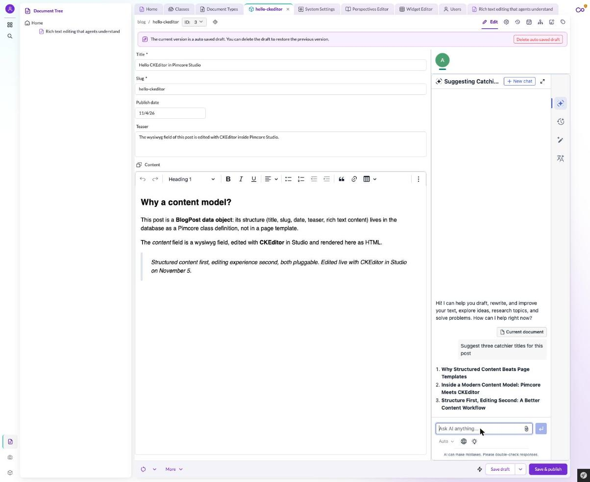

# Pimcore AI Guidepost

A Pimcore 2026.3 project wired up with every AI-assisted development resource the Pimcore ecosystem offers today, plus a CKEditor integration for Pimcore Studio. It was prepared by Ondřej Chrastina (Developer Advocate at CKEditor) for the talk "AI Best Practices for Your Product" at [Pimcore Community Dev Days 2026](https://pretix.eu/pluswerk/pcdd26/) (Frankfurt, 2026-11-10). Clone it to get a working coding-agent setup for Pimcore, a map of where Pimcore's AI resources live, and a set of small demos you can run locally.



*CKEditor editing a blog post in Pimcore Studio, with CKEditor AI docked next to the content.*

New here? Start with [`AGENTS.md`](AGENTS.md): it is the guidepost itself (the resource map and the next steps), and the same content is served as the Home page of the running site.

## What's inside

- **A working agent setup**: 43 vendored agent skills plus one project-local skill, readable by Claude Code, Codex, Copilot, Gemini CLI and other agents. See [Agent setup](#agent-setup).
- **A map of Pimcore's AI resources**: [`AGENTS.md`](AGENTS.md) lists docs for LLMs, skills repos, the Datahub MCP server, the Pimcore Agent and more. The `app:guidepost:seed` command turns it into the site's Home page.
- **CKEditor in Pimcore Studio**: [`packages/ckeditor-studio-bundle`](packages/ckeditor-studio-bundle/README.md) mounts CKEditor as Studio's rich text editor. See [CKEditor in Pimcore Studio](#ckeditor-in-pimcore-studio).
- **Demos**:
  - BlogPost data objects rendered at `/blog` (`ckeditor-studio:install-blog-demo`).
  - A "Landing page" document type ([`templates/landing/`](templates/landing/landing.html.twig)) for pages such as `/landing`.
  - A generated two-host podcast about Pimcore in [`podcast/`](podcast/README.md), built from the public resources the guidepost maps.
  - [`bin/demo-preflight`](bin/demo-preflight): checks the stack before a demo.
- **Findings**: what the agent skills covered and where the next steps are. See [Findings and next steps](#findings-and-next-steps).

## Quick start

Prerequisites: Docker with Docker Compose. You do not need PHP or Composer on your machine; every PHP command runs inside the `php` container.

1. Clone with submodules. The Pimcore skills are git submodules, and without them every Pimcore skill symlink in `.claude/skills/` points at an empty folder.

   ```bash
   git clone --recurse-submodules https://github.com/Simply007/pcdd26-pimcore-ai-guidepost.git
   cd pcdd26-pimcore-ai-guidepost
   ```

   Already cloned, or working in a new git worktree? Run `git submodule update --init` once.

2. Start the stack and install the PHP dependencies.

   ```bash
   docker compose up -d
   docker compose exec php composer install
   ```

3. Install Pimcore.

   ```bash
   docker compose exec php vendor/bin/pimcore-install --install-profile='App\Installer\SkeletonProfile'
   ```

   The committed `.env` answers every installer question except one: Pimcore asks for a product key. Registration is free for the Community edition at <https://license.pimcore.com/register> (the installer prints a prefilled link). Instance-specific values end up in `.env.local`, which is gitignored; keep it that way. The admin login comes from `.env`; change the password after first login.

4. Publish the bundle assets and seed the demo content.

   ```bash
   docker compose exec php bin/console assets:install public --symlink --relative
   docker compose exec php bin/console app:guidepost:seed
   docker compose exec php bin/console ckeditor-studio:install-blog-demo
   ```

   `app:guidepost:seed` rewrites the Home document with the `AGENTS.md` content and is safe to re-run (it overwrites manual edits on that page). `ckeditor-studio:install-blog-demo` creates the BlogPost class and two sample posts.

5. Open the site.

   | URL | What you see |
   |---|---|
   | <http://localhost/> | The guidepost (Home document) |
   | <http://localhost/blog> | BlogPost data objects, for example `/blog/hello-ckeditor` |
   | <http://localhost/landing> | A page of the "Landing page" document type, once you create one in Studio with the key `landing` |
   | <http://localhost/pimcore-studio/> | Pimcore Studio, the admin UI |

6. Optional: run `bin/demo-preflight` from the repository root. It checks the containers, the demo pages, the published editor build, the editor selection and which CKEditor premium features are on (states only, never key values). It also checks two pages created by hand for the talk (`/landing` and `/blog/preparing-for-ai-coding-agents`), so on a fresh install expect those two to fail until you create them.

More Docker notes, the Codeception test commands and the Platform Version explanation are in [`docs/skeleton.md`](docs/skeleton.md).

## Agent setup

- [`AGENTS.md`](AGENTS.md) is the entry point for every coding agent: what the repo is built from, the Pimcore AI resource map, working rules, and the next steps.
- [`CLAUDE.md`](CLAUDE.md) holds a single line, `@AGENTS.md`. That is Claude Code's import syntax: Claude Code reads `CLAUDE.md` and pulls in `AGENTS.md`, so every agent shares one source of truth.
- `.claude/skills/` is the folder Claude Code loads skills from. `.agents/skills/` is the [agentskills.io](https://agentskills.io) location that Codex, Copilot, Gemini CLI and other agents read.

### Skills map

| Source | Count | Lives in | Shows up in `.claude/skills/` as |
|---|---|---|---|
| [pimcore/skills](https://github.com/pimcore/skills) (official, Pimcore Studio bundle development) | 33 | `skills-vendor/pimcore-skills/` (git submodule) | symlinks `pimcore-studio-backend-*`, `pimcore-studio-bundle-setup`, `pimcore-studio-ui-*` |
| [cors-gmbh/pimcore-skills](https://github.com/cors-gmbh/pimcore-skills) (community, platform-wide) | 7 | `skills-vendor/cors-pimcore-skills/` (git submodule) | symlinks `pimcore`, `pimcore-studio`, `pimcore-studio-migrate`, `pimcore-12-upgrade`, `coreshop`, `cla-setup`, `cors-dev-setup` |
| [ckeditor/skills](https://github.com/ckeditor/skills) via [skills.sh](https://skills.sh) | 3 | `.agents/skills/` (real files, pinned in `skills-lock.json`) | symlinks `ckeditor`, `ckeditor-bundle`, `ckeditor-update` |
| This repository | 1 | `.claude/skills/pimcore-onboarding/` (real folder) | `pimcore-onboarding` |

`pimcore-onboarding` is the one skill grown here: answers to the orientation questions a first-time Pimcore developer actually asked while building this repo (Pimcore vs Pimcore Studio, product registration, docs access for agents, known traps).

### Adding skills

- From a git repository (the route used for the Pimcore skills): add it as a submodule under `skills-vendor/`, then symlink each skill folder into `.claude/skills/`, for example `ln -s ../../skills-vendor/<repo>/skills/<skill> .claude/skills/<skill>`.
- From skills.sh (the route used for CKEditor): `npx skills add <owner>/<repo>` installs into `.agents/skills/` and records the source in `skills-lock.json`; add a symlink in `.claude/skills/` so Claude Code sees it too.
- Project knowledge: write a `SKILL.md` in a new folder under `.claude/skills/`, with `pimcore-onboarding` as an example.

## CKEditor in Pimcore Studio

[`packages/ckeditor-studio-bundle`](packages/ckeditor-studio-bundle/README.md) (`Simply007\CKEditorStudioBundle`) is a CKEditor counterpart to `pimcore/quill-bundle`. It replaces Studio's wysiwyg editor component, so data object wysiwyg fields and document editables render CKEditor.

- Classic editor everywhere, plus an inline editor option for document editables (the Landing page document type uses it).
- Toolbar configurable in `config/packages/ckeditor_studio.yaml`, with a default preset.
- Editor selection `ckeditor`, `quill` or `default`, so Quill and CKEditor can stay installed side by side.
- Runs the open source feature set with no key. With a CKEditor license key, optional CKEditor AI and real-time collaboration can be switched on through environment variables in `.env.local`; a free trial at [portal.ckeditor.com](https://portal.ckeditor.com/) covers both.

Setup, configuration, the premium path and known limitations are in the [bundle README](packages/ckeditor-studio-bundle/README.md). The bundle is also being extracted into its own installable package ([issue #3](https://github.com/Simply007/pcdd26-pimcore-ai-guidepost/issues/3)).

## Pimcore in 60 seconds

- **Pimcore**: an open core data and experience management platform built on Symfony (PHP). One installation covers content management, digital asset management and product information management.
- **Pimcore Studio**: Pimcore's new React and TypeScript admin UI (`studio-ui-bundle` plus `studio-backend-bundle`), the successor of the classic ExtJS admin. It lives at `/pimcore-studio/`.
- **Documents**: CMS pages. Each Document points to a controller and a Twig template and sits in a page tree that maps to URLs (the Home page here is Document id 1).
- **Editables**: the editable regions inside a Document's template, such as `pimcore_input('headline')` or `pimcore_wysiwyg('intro')`. Editors fill them in Studio's edit mode; the names in the template are the page's schema.
- **Data Objects**: structured records defined by classes you build in the class editor (here: `BlogPost`). Pimcore generates PHP classes and database tables from them. Used for products, blog posts, anything with fields.
- **Assets**: files such as images, videos and PDFs, managed in their own tree.
- **Finding things in Studio**: Documents, Assets and Data Objects each have a tree in Studio's left icon bar. The Data Object Tree is the cube icon at the bottom of that bar.

The project-local [`pimcore-onboarding`](.claude/skills/pimcore-onboarding/SKILL.md) skill goes a bit deeper and is written for humans too.

## Findings and next steps

Building this repo with agent skills produced three notes. Each one is written as next steps for the ecosystem:

| File | What it holds |
|---|---|
| [`AGENTS.md`](AGENTS.md), "Where to go next" | Ecosystem-level next steps: evals for skills, `AGENTS.md` in the main repos, `llms.txt` at the docs root, one-command skills install, a decision trail for the Pimcore Agent |
| [`docs/demo-findings.md`](docs/demo-findings.md) | Building the guidepost as a Pimcore Document: what the skills covered, what came from the skeleton and vendor source, surprising Pimcore behavior, the editable inventory |
| [`packages/ckeditor-studio-bundle/SKILL-FINDINGS.md`](packages/ckeditor-studio-bundle/SKILL-FINDINGS.md) | Building the CKEditor Studio bundle step by step: which skill guided each step and where `pimcore/quill-bundle` source filled the gaps |

Open issues on this repository track individual follow-ups, for example the [`llms.txt` link base path](https://github.com/Simply007/pcdd26-pimcore-ai-guidepost/issues/1).

## Based on pimcore/skeleton

This project started as `composer create-project pimcore/skeleton` on the Pimcore 2026.3 line (`pimcore/pimcore` and `pimcore/platform-version` `^2026.3.0`). The standard skeleton layout is unchanged: `docker-compose.yaml` for services, `bin/console` for commands, `config/` for Symfony configuration, `src/` for code, `templates/` for Twig. The skeleton's own README content (fresh-project setup, Docker notes, tests, Platform Version) now lives in [`docs/skeleton.md`](docs/skeleton.md). `CONTRIBUTING.md` and `SECURITY.md` are the skeleton's upstream files and describe contributing to Pimcore itself.

## Contributing

Issues and pull requests are welcome, especially corrections to the resource map and new findings.

- Run PHP through the container (`docker compose exec php ...`); the host PHP usually lacks the required extensions.
- Commits follow [Conventional Commits](https://www.conventionalcommits.org/): `type(scope): imperative summary`, one logical change per commit.
- Never commit `.env.local` or any keys.
- When an agent skill or `AGENTS.md` turns out to be wrong, update it in the same change that fixes the problem.

## License

[`LICENSE.md`](LICENSE.md) is the Pimcore Open Core License (POCL) that ships with `pimcore/skeleton`, and the root `composer.json` declares `"license": "proprietary"`, also inherited from the skeleton. Parts of the repository carry their own licenses:

- `packages/ckeditor-studio-bundle`: GPL-2.0-or-later, see its `LICENSE` (the committed build bundles CKEditor's open source packages, which are GPL-2.0-or-later; CKEditor premium features need a commercial license key).
- `skills-vendor/pimcore-skills`: POCL, see its `LICENSE.md`.
- `skills-vendor/cors-pimcore-skills`: MIT, see its `LICENSE`.

## Credits

- Prepared by Ondřej Chrastina ([GitHub](https://github.com/Simply007)), Developer Advocate at CKEditor.
- Built on [pimcore/skeleton](https://github.com/pimcore/skeleton) by Pimcore GmbH.
- Official agent skills: [pimcore/skills](https://github.com/pimcore/skills) by Pimcore GmbH.
- Community agent skills: [cors-gmbh/pimcore-skills](https://github.com/cors-gmbh/pimcore-skills) by CORS GmbH.
- CKEditor agent skills: [ckeditor/skills](https://github.com/ckeditor/skills).
